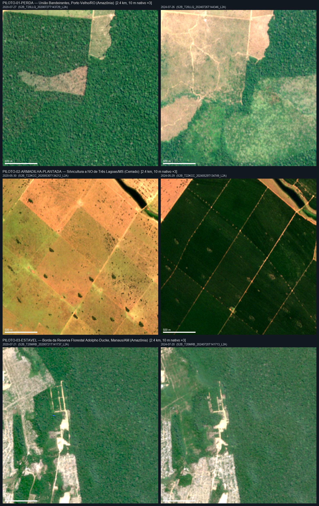

# GeoDetective Brasil — Primeira entrega (planejamento + base de imagens)

*Data: 2026-11-12 · Referência: proposta "GeoDetective_Brasil_Proposta_PROCESSAMENTO_PREVIO" (Spate Tech Bootcamp 2026)*

Esta entrega cobre os itens 1–10 da "Primeira entrega". **Nada do jogo foi implementado** e nenhum resultado de ML existe ainda.
Os índices de "triagem" citados abaixo servem só para **escolher recortes**. Não são resultados do modelo nem a referência do jogo.

---

## 1. Resumo do que foi executado (e verificado)

| Item | Status | Evidência |
|---|---|---|
| Leitura da proposta | ✅ | — |
| Fontes de imagem testadas por API (3 catálogos STAC) | ✅ | `science/scripts/diagnostics/probe_stac.py` |
| **3 pares reais 2020 × 2024 (perda, armadilha plantada, estabilidade)** | ✅ verificados | `data/pairs/PILOTO-0*/`, `data/catalog/pairs_catalog.csv` |
| Alvo = **somente vegetação nativa** | ✅ decidido | seção 2.1 |
| Imagens do jogo otimizadas para o olho humano (2,4 km, ×3) | ✅ | seção 4.1 |
| Par de **ganho nativo** | ⛔ não encontrado (4 tentativas rejeitadas) | seção 5.2.1 |
| Alinhamento pixel a pixel (CRS, transform e dimensões idênticos) | ✅ 3/3 | `verify_pairs.py` → `metadata.json/verification` |
| Município (API IBGE) e links de proveniência (12/12 HTTP 200) | ✅ | `verify_pairs.py`, `check_links.py` |
| Lista preliminar de 50 localidades | ✅ proposta | `data/catalog/candidates_v0.csv` |
| UF/bioma oficiais (IBGE) e disponibilidade de Sentinel-2 das 50 | ✅ 50/50 conferidas | `data/catalog/candidates_v0_verified.csv` |
| Pares tentados e **rejeitados** (fumaça) | ✅ documentados | seção 5.3 |
| Rótulos MapBiomas | ⛔ não obtidos | download público suspenso (seção 3) |



---

## 2. Decisões técnicas não resolvidas e riscos metodológicos

Os riscos abaixo foram **observados nos dados** durante a triagem. Não são apenas hipotéticos.

### 2.1 Definição do alvo "cobertura vegetal" — ✅ DECIDIDO (2026-11-12): **somente vegetação nativa**
Alvo = classes MapBiomas de nível 1 **"Floresta"** e **"Vegetação Herbácea e Arbustiva"** (formações naturais).
**Silvicultura, agricultura e pastagem são "não-alvo"**, mesmo quando verdes. Motivo, com evidência da triagem:
- **Três Lagoas/MS:** pasto → eucalipto dá cerca de **+91 pp** de dossel arbóreo no recorte, mas Δ de vegetação *nativa* ≈ 0. O par virou **PILOTO-02-ARMADILHA-PLANTADA** ("mais árvores ≠ mais vegetação nativa").
- **Petrolina/PE (candidato):** a fruticultura irrigada deixa a paisagem *mais verde* enquanto remove Caatinga nativa.
- **Pampa:** o campo nativo *é* alvo, mas é espectralmente parecido com pastagem e lavoura. Esse é o maior risco de classificação.

Consequência para o ML: a classe "não-nativa verde" (silvicultura, lavoura, pasto) precisa ser bem amostrada no treino.
Consequência para os candidatos: CER-01, PAM-02 e CAP-SC (pinus) são armadilhas didáticas, não casos de ganho.

### 2.2 Qual é a "referência de avaliação" do jogador?
A proposta cita o resultado do ML *e* uma referência. Proposta de organização:
- **Pontuação** contra a **estimativa do modelo** (Δ em pp), exibida com a sua incerteza.
- **Referência independente** (MapBiomas Col. 11 + pontos fotointerpretados) usada para *validar o modelo* e exibida como transparência ("o MapBiomas estima X").
- Se modelo e referência divergirem mais que um limiar (ex.: 10 pp), o desafio é revisado ou excluído.

### 2.3 Métricas — revisão crítica da proposta
- **F1 e matriz de confusão:** adequadas para a classificação por pixel. Reportar F1 por classe e por bioma, não só o global.
- **"Erro absoluto percentual" (MAPE): inadequado.** Para desafios estáveis o Δ verdadeiro é cerca de 0, e o MAPE divide por zero ou explode. Substituir por:
  - **MAE e viés (em pp)** da proporção de vegetação de cada data e do **Δ** por desafio;
  - **erro de Δ em áreas estáveis** (taxa de falsa mudança). Erros de duas classificações independentes se somam, e o "Δ espúrio" é o principal risco da abordagem pós-classificação;
  - estimativas de área ajustadas por erro e intervalos de confiança, seguindo as boas práticas de Olofsson et al. (2014, *Remote Sensing of Environment* 148:42–57).

### 2.4 Validação espacial
Pixels vizinhos são autocorrelacionados. Um split aleatório infla o F1.
Usar **blocos espaciais** (ex.: 10 × 10 km) ou *leave-one-site-out*. As amostras de treino devem vir de **fora dos 50 recortes do jogo**, para que os desafios funcionem como teste independente.

### 2.5 Rótulos MapBiomas × Sentinel-2
- MapBiomas é Landsat **30 m** e anual. As imagens do jogo são S2 **10 m** de um único dia. Bordas e pixels mistos geram rótulos errados.
  - Amostrar só pixels **interiores** (erosão de 1–2 pixels de 30 m).
  - Usar pixels **estáveis em três anos consecutivos** (ex.: 2019–2021 para 2020), para maior pureza.
- O MapBiomas também tem erros ("amostras independentes revisadas", como prevê a proposta): fotointerpretar um subconjunto.

### 2.6 Nuvens finas e fumaça — o SCL não basta (observado 3 vezes)
- **Ducke 2020:** cirros finos classificados como válidos (fora do recorte final, mas dentro da região).
- **Pantanal 2020-09-28** e **Matupi 2024-08-02:** fumaça densa de queimadas classificada como **válida** pelo SCL.

**Ação:** acrescentar um QA de névoa e fumaça (banda AOT do L2A e/ou **Cloud Score+**), e manter **inspeção visual obrigatória** de cada par antes da aprovação.

### 2.7 Sazonalidade e seca (observado)
- **Apuí 2024:** o pasto inteiro ficou amarelo (seca amazônica 2023–24). O limiar NDVI indicou −57 pp numa janela **sem desmatamento**.
- **Floresta da Tijuca:** deslocamento sistemático de −15 pp num índice com limiar fixo.

Consequências:
- Limiares fixos não se transferem entre datas.
- O RF deve ser treinado com amostras **das duas datas e de várias estações**, com bandas SWIR (B11/B12) e red-edge, que separaram floresta de pasto melhor que o NDVI.
- O jogo deve **ensinar** essa armadilha (desafio AMZ-03).

### 2.8 Consistência radiométrica 2020 × 2024 (resolvido)
O Sentinel-2 mudou o *processing baseline* em 2022 (offset −1000 no L2A).
- O **Planetary Computer** ainda serve 2020 no baseline **02.12**.
- O **Earth Search `sentinel-2-c1-l2a`** e o **CDSE** servem 2020 **reprocessado no baseline 05.00** (Collection 1), consistente com 2024 (05.10/05.11). Os dois anos declaram `scale=0.0001, offset=-0.1`, e o pipeline aplica esses valores a partir dos metadados.

### 2.9 Outros riscos
- **Degradação ≠ perda de cobertura:** no PILOTO-01, o canto SE em 2024 mostra floresta degradada (fogo ou extração) sem corte raso. O modelo binário provavelmente não captura isso. Explicar no feedback.
- **Capitais costeiras do NE** (João Pessoa, Recife, Natal) **não têm cena limpa** na janela set–dez com o filtro atual. Ampliar a janela, relaxar o filtro do tile e checar nuvem no recorte, ou aceitar 2025.
- **Escala −100…+100:** os Δ reais esperados ficam majoritariamente entre −30 e +30 pp, então a pontuação precisa ser sensível nessa faixa (seção 7.3).
- **Mudanças fora do escopo** (água, enchente de 2024 em Porto Alegre, dunas): manter como controles explícitos.

---

## 3. Fontes de dados investigadas

| Fonte | Uso no projeto | Acesso testado | Observações |
|---|---|---|---|
| **Earth Search (Element 84) — `sentinel-2-c1-l2a`** | **Fonte primária** de pixels (COGs no AWS Open Data) | ✅ STAC + leitura por janela, sem conta | Collection 1 (baseline 05.xx em 2020 e 2024); `scale/offset` nos metadados |
| **Copernicus Data Space Ecosystem (CDSE)** | **Proveniência oficial** (ID do produto ESA) e Copernicus Browser | ✅ STAC aberto | Download de arquivos exige conta gratuita; mesmo produto ESA |
| Microsoft Planetary Computer | Alternativa | ✅ STAC | 2020 no baseline 02.12: exige harmonização |
| **MapBiomas Brasil Col. 11** (1985–**2025**, 30 m, ago/2026) | Rótulos e referência | ⛔ GeoTIFFs no GCS retornam **HTTP 403**; a página oficial diz que o download de mapas está "temporariamente suspenso" | Alternativa: Google Earth Engine (conta gratuita não comercial) ou o *user-toolkit* do MapBiomas |
| **IBGE — API de malhas v3** | Município e UF de cada recorte | ✅ | Usado na verificação automática |
| **IBGE — Biomas 1:250.000 (2019)** | Bioma oficial de cada recorte | ✅ baixado | `data/external/ibge/biomas/` |

**Licenças:**
- Sentinel-2: *Legal Notice on the use of Copernicus Sentinel Data* (uso livre). Ao publicar imagens processadas: *"Contains modified Copernicus Sentinel data 2020, 2024"*.
- MapBiomas: CC-BY 4.0 (conforme o catálogo do Earth Engine), com citação da coleção.
- IBGE: dados públicos, com citação da fonte.

**Bandas:**
- **ML:** B02, B03, B04, B08 (10 m); B05, B06, B07, B8A, B11, B12 (20 m → 10 m bilinear); SCL para máscara.
- **Índices sugeridos:** NDVI, NDMI (B8/B11), NBR (B8/B12), NDRE (B8A/B05), MNDWI (B3/B11).
- **Jogo:** cor verdadeira B04/B03/B02, otimizada para visão humana (seção 4.1). Falsa-cor B08/B04/B03 opcional como "modo especialista".

---

## 4. Critérios de recorte e de par

- **Grade:** área de busca de 6 × 6 km e **recorte do jogo de 2,4 × 2,4 km** (240 × 240 px a 10 m), em UTM, encaixados na grade de 60 m do Sentinel-2. As duas datas são lidas **na mesma grade**, com alinhamento verificado. O Δ científico será calculado **exatamente sobre o recorte exibido**.
- **Posição do recorte:** escolhida automaticamente dentro da área de busca, conforme o tipo de desafio:
  - `loss`: maior perda;
  - `gain`: maior ganho;
  - `stable_edge`: Δ ≈ 0, mas com uma borda visível (contraste).

  O posicionamento usa um proxy de dossel (NDVI > 0,7 e B11 < 0,16), registrado no `metadata.json`. **Esse proxy não é o resultado do modelo.**
- **Mesmo local:** mesmo tile MGRS e mesma órbita relativa (mesma geometria de visada). Nos três pilotos isso vale para as duas condições.
- **Sazonalidade:** janela fixa por bioma e região, escolhendo o par com a menor diferença de dia do ano (pilotos: 1 dia).
- **Qualidade:** cobertura total do recorte pelo *footprint* da cena, ≥ 97 % de pixels válidos pelo SCL, QA de névoa e fumaça (a implementar) e QA visual.
- **Prévias:** nunca usar estiramento por imagem, porque isso faria uma data parecer mais verde sem mudança real.

### 4.1 Visualização para o olho humano (zoom máximo sem "estourar")
Estudo de zoom no PILOTO-01, sempre com 600 px de largura na tela (`science/scripts/diagnostics/zoom_study.py`, saídas em `data/zoom_study/P01/`):

| Recorte | Ampliação | Avaliação visual |
|---|---|---|
| 5 km | ×1 | nítido, mas os detalhes ficam pequenos (muito campo) |
| 3 km | ×2 | nítido; talhões, estradas e borda da floresta claros |
| **2,4 km** | **×3** | **escolhido**: limite antes de ficar borrado |
| 2 km | ×3 | aceitável, levemente macio |
| 1,5 km | ×4 | borrado ("estoura") |

Decisão: **recorte de 2,4 km, 10 m nativo, ampliado ×3 com Lanczos → imagem de 720 × 720 px.**
- Não há super-resolução nem *sharpening*: 10 m é o limite real do Sentinel-2. Inventar detalhe violaria a integridade das imagens.
- Se a tela do jogador for maior, o navegador amplia a partir dos 720 px, sem detalhe novo.

**Tom compartilhado pelo par.** O tom é calculado uma vez sobre as duas datas juntas e aplicado com os mesmos números em ambas:
- preto e branco nos percentis 0,5 e 99 dos três canais juntos (preserva o equilíbrio de cor);
- **gama automática**, que leva a mediana do par a 36 % de brilho. Sem isso, a floresta virava preto quando havia cidade clara no recorte (caso Ducke);
- saturação de +12 %, igual nas duas datas.

Os parâmetros de cada par ficam em `metadata.json → display.tone`.

---

## 5. Pares de imagens

### 5.1 Pares verificados

Recortes de 2,4 × 2,4 km, regenerados após a decisão "só nativa" e a otimização visual:

| ID | Local (IBGE) | Centro do recorte (lon, lat) | Datas | Tile / órbita | Nuvem do tile | Válido no recorte | Triagem Δ dossel* |
|---|---|---|---|---|---|---|---|
| PILOTO-01-PERDA | União Bandeirantes, **Porto Velho/RO** (1100205), Amazônia | −64.460349, −9.802103 | 2020-07-27 × 2024-07-26 | 20LLQ / R096 | 19,1 % / 0,0 % | 100 % / 100 % | −63 pp |
| PILOTO-02-ARMADILHA-PLANTADA | **Três Lagoas/MS** (5008305), Cerrado | −51.965583, −20.570203 | 2020-05-30 × 2024-05-29 | 22KCC / R124 | 0,0 % / 0,0 % | 100 % / 100 % | +91 pp de eucalipto (Δ nativa esperado ≈ 0) |
| PILOTO-03-ESTAVEL | Borda da Reserva Ducke, **Manaus/AM** (1302603), Amazônia | −59.971676, −2.971071 | 2020-07-21 × 2024-07-20 | 20MRB / R010 | 4,4 % / 0,0 % | 99,9 % / 99,9 % | +1,2 pp |

\* Proxy de dossel arbóreo, usado só para posicionar o recorte. Não distingue nativo de plantado e **não é o resultado do modelo**.

Recortes (bbox lon/lat):
- P01: −64.471336, −9.813000, −64.449362, −9.791206
- P02: −51.977164, −20.581109, −51.954004, −20.559297
- P03: −59.982489, −2.981942, −59.960863, −2.960201

Identificadores oficiais (ESA/CDSE):

| ID | 2020 | 2024 |
|---|---|---|
| P01 | `S2B_MSIL2A_20200727T143729_N0500_R096_T20LLQ_20230325T001133` | `S2B_MSIL2A_20240726T143749_N0511_R096_T20LLQ_20240726T185603` |
| P02 | `S2B_MSIL2A_20200530T134209_N0500_R124_T22KCC_20230405T065924` | `S2B_MSIL2A_20240529T133839_N0510_R124_T22KCC_20240529T204948` |
| P03 | `S2B_MSIL2A_20200721T141739_N0500_R010_T20MRB_20230323T122052` | `S2B_MSIL2A_20240720T141719_N0510_R010_T20MRB_20240720T163517` |

Links verificáveis (todos testados com HTTP 200 em 2026-11-12):
- Item STAC do CDSE: `https://stac.dataspace.copernicus.eu/v1/collections/sentinel-2-l2a/items/<ID acima>`
- Item STAC do Earth Search, por exemplo:
  - https://earth-search.aws.element84.com/v1/collections/sentinel-2-c1-l2a/items/S2B_T20LLQ_20200727T143729_L2A
  - https://earth-search.aws.element84.com/v1/collections/sentinel-2-c1-l2a/items/S2B_T20LLQ_20240726T144346_L2A
- Copernicus Browser (visualização no dia exato): campo `url_copernicus_browser` em `data/catalog/pairs_catalog.csv`. Esse link abre a interface web e **não foi testado automaticamente**.

A tabela completa, uma linha por imagem com todos os campos do catálogo pedido, está em `data/catalog/pairs_catalog.csv`. Os metadados para reprodução estão em `data/pairs/<ID>/metadata.json`.

### 5.2 Leitura dos pilotos (ressalvas)
- **P01:** corte raso de floresta para pasto entre 2020 e 2024, claramente visível. O canto SE de 2024 mostra floresta **degradada** (mais clara e manchada, provavelmente fogo ou extração) sem corte raso: o modelo precisa decidir se isso ainda é vegetação nativa.
- **P02:** pasto → eucalipto. Com o alvo "só nativa", é o **desafio-armadilha**. A mata ciliar nativa no canto NE deve ser conferida com o MapBiomas.
- **P03:** recorte movido para a **borda reserva × cidade**, com contraste visual e Δ do proxy de +1,2 pp. Há expansão urbana local no sul do recorte e possível rebrota a NO. O resultado do modelo vai dizer se o líquido é ≈ 0.

### 5.2.1 Par-piloto de **ganho de vegetação nativa**: ainda não encontrado
Tentativas desta rodada, todas rejeitadas:
- **São Luiz do Paraitinga/SP:** o "ganho" é eucalipto replantado após o corte (estradas em curva de nível típicas de plantio).
- **Mariana/MG:** o mesmo padrão de silvicultura, e há nuvem em 2024.
- **Pantanal, Encontro das Águas, out/2020 × out/2025:** fumaça em 2020, de novo marcada como válida pelo SCL. Além disso, o verde de 2025 mistura recuperação pós-fogo com o início das chuvas.
- **Pantanal, nov/2020 × nov/2025:** nuvens em 2025, e em 2020 as chuvas já tinham começado.

Ganho nativo em 4 anos é raro e pequeno na escala de 10 m. A maior parte do "ganho verde" visível é plantio.
**Estratégia proposta:** usar os produtos MapBiomas de **vegetação secundária** e **MapBiomas Fogo** (via Earth Engine) para localizar regeneração confirmada, e só então buscar o par Sentinel-2.

### 5.3 Pares tentados e rejeitados ou não confirmados

| Região | Motivo |
|---|---|
| Pantanal, Encontro das Águas (2020-09-28 × 2025-09-27) | 2020 coberto por **fumaça**: rejeitado. Testar outras datas no fim de 2020. |
| Manicoré, Santo Antônio do Matupi (2024-08-02) | **Fumaça** em 2024: rejeitado. |
| Brumadinho, Córrego do Feijão | Hipótese de "ganho" **não confirmada**: rejeito ainda exposto em 2024. |
| Apuí, janela de "perda" por NDVI | Falso positivo causado pelo **pasto seco**. A floresta caiu só cerca de 7 pp. |

---

## 6. Obtenção automática

O ambiente usado nos testes é Windows com Python 3.14. O venv fica em caminho curto porque as DLLs do GDAL falham com caminhos longos.

```bash
python -m venv C:\Users\<voce>\.venvs\geodet
```

```bash
C:\Users\<voce>\.venvs\geodet\Scripts\python -m pip install -r science/requirements.txt
```

Reproduzir os três pares a partir dos IDs fixos, verificar e catalogar:

```bash
python science/scripts/build_from_catalog.py data/catalog/pilots.json
```

```bash
python science/scripts/verify_pairs.py
```

```bash
python science/scripts/check_links.py
```

```bash
python science/scripts/summarize_pairs.py
```

Triagem de uma região nova (encontra janelas de 5 km com perda, ganho ou estabilidade):

```bash
python science/scripts/screen_region.py --name exemplo --lon -64.53 --lat -9.76 --size 24000 --season 06-01 08-31 --metric forest
```

Verificar a lista de 50 localidades (IBGE + disponibilidade de Sentinel-2):

```bash
python science/scripts/verify_candidates.py
```

Como funciona:
1. Busca no STAC (sem conta).
2. Filtra cenas cujo *footprint* contém o recorte inteiro.
3. Calcula a fração válida pelo SCL **dentro do recorte**.
4. Escolhe o par sazonalmente mais próximo.
5. Lê **só a janela necessária** dos COGs via HTTP.
6. Posiciona o recorte de 2,4 km dentro da área de busca de 6 km.
7. Grava:
   - GeoTIFF do recorte (10 bandas, reflectância × 10000, int16) e SCL;
   - `game_<data>.png` (720 px, ×3);
   - `context_<data>.png` (6 km, com o recorte em amarelo);
   - `metadata.json`.

---

## 7. Arquitetura recomendada

### 7.1 Separação
```
science/  (Python, offline)  ──gera──▶  data/game/challenges.json + imagens WebP  ──consumido por──▶  game/ (site estático)
```
O jogo **nunca** executa ML. O contrato entre as partes é um JSON versionado (`schema_version`) com, para cada desafio:
- imagens e local;
- datas e IDs dos produtos;
- `model_estimate_pp` e incerteza, `reference_pp`;
- limitações e licenças.

Reprocessar o modelo regenera só esse JSON.

### 7.2 Tecnologias
- **Científico:**
  - `pystac-client` + `rasterio` (leitura de COGs por janela, sem baixar tiles inteiros);
  - `scikit-learn` (Random Forest);
  - `earthengine-api` **apenas** para rótulos MapBiomas e Cloud Score+, enquanto o download do MapBiomas estiver suspenso.
- **Jogo:** site estático com **Vite + TypeScript + Svelte**:
  - leve, sem servidor, publicável no **GitHub Pages** (gratuito);
  - mapa de progresso em **SVG das UFs** simplificado a partir da malha do IBGE, sem servidor de tiles;
  - comparação de imagens lado a lado, com **cortina deslizante**, possível porque as grades são idênticas.

### 7.3 Pontuação (proposta transparente)
`pontos = round(100 × max(0, 1 − max(0, |estimativa − Δ_modelo| − tolerância) / 40))`, com `tolerância = incerteza do modelo` (ex.: ±3 pp).
- Acertar dentro da incerteza vale 100 pontos.
- Errar por 40 pp além da incerteza vale 0.
- A fórmula fica publicada na tela de resultado.

---

## 8. Estrutura do repositório

```
geodetective-brasil/
├── README.md
├── docs/                     # planejamento, decisões, métodos (esta entrega)
├── science/
│   ├── requirements.txt
│   ├── geodet/               # biblioteca: s2.py (STAC/leitura), pairing.py, render.py
│   └── scripts/              # screen_region, build_pair, build_from_catalog, verify_*, check_links, summarize_pairs
│       └── diagnostics/      # sondagens de fontes (STAC, offsets, MapBiomas)
├── data/
│   ├── catalog/              # candidates_v0(.verified).csv, pilots.json, pairs_catalog.csv
│   ├── pairs/<ID>/           # GeoTIFFs (gitignored), PNGs, metadata.json
│   ├── screening/            # triagens (json + png)
│   └── external/             # IBGE etc. (gitignored; baixável)
└── game/                     # (vazio — Etapa 7)
```
Os GeoTIFFs não vão para o Git (cerca de 9 MB por par, mais de 450 MB para 50 pares). São reprodutíveis pelos scripts. A versão final deve ser arquivada no **Zenodo** com DOI.

---

## 9. Lista preliminar das 50 localidades

Arquivo: `data/catalog/candidates_v0.csv`. Versão conferida: `candidates_v0_verified.csv`.

| Grupo | Quantidade | Distribuição de hipóteses |
|---|---|---|
| Biomas | 18 (3 × 6) | perda 6 · estável 8 · ganho/recuperação 4 (2 com vegetação plantada) |
| Capitais | 27 | expansão urbana (perda) · remanescentes urbanos (estável) · casos especiais (Maceió, Florianópolis, Porto Alegre) |
| Complementares | 5 | Brumadinho, TI Apyterewa, Lençóis Maranhenses (controle sem vegetação), Mariana, Ilha do Bananal |

Conferência automática (50/50):
- **UF e bioma batem com o IBGE em todos os pontos.**
- Alertas:
  - **CAP-GO** caiu em *Aparecida de Goiânia*: mover o ponto para dentro de Goiânia.
  - **CAP-PB, CAP-PE e CAP-RN** não têm cena limpa na janela atual.
  - **PAN-01** (2024) e **PAM-02** têm pouca disponibilidade de cenas.

Importante: **as coordenadas marcadas como "aproximada" são pontos de partida, não recortes verificados.** Cada uma passa por triagem e QA antes de virar desafio, como aconteceu com os pilotos.

---

## 10. Primeira implementação prática recomendada

Uma "fatia vertical" científica com os 3 pilotos, antes de escalar para 50:
1. **QA de névoa e fumaça** (AOT + Cloud Score+) no `pairing.py`, testado contra os casos rejeitados (Pantanal 2020, Matupi 2024).
2. **Rótulos MapBiomas Col. 11** via Earth Engine para 2020 e 2024 em blocos de treino **fora** dos recortes do jogo, com erosão de bordas e filtro de estabilidade temporal. Requer que você crie uma conta GEE não comercial.
3. **RF baseline** com bandas + índices, validação por blocos espaciais e métricas da seção 2.3. Aplicar aos 3 pilotos e comparar Δ_modelo × Δ_MapBiomas.
4. **Encontrar um par de ganho nativo** a partir da vegetação secundária e do MapBiomas Fogo (seção 5.2.1).

Só depois disso: triagem das 47 localidades restantes (Etapas 2–3 em lote) e o export `challenges.json` para o jogo.

### Sequência de etapas revisada
1. Planejamento ✅
2. Pesquisa geográfica (v0 ✅, triagem de 47 pendente)
3. Aquisição (pipeline ✅, 3/50 pares)
4. **Definição do alvo + QA de nuvem e fumaça** (nova; bloqueia a 5)
5. Processamento e ML na fatia vertical de 3 pilotos
6. Escala para 50 desafios + export do JSON
7. Jogo
8. Integração
9. Testes científicos e de usabilidade
10. Publicação (GitHub + Zenodo)

---

## Fontes consultadas
- Earth Search STAC: https://earth-search.aws.element84.com/v1
- CDSE STAC: https://stac.dataspace.copernicus.eu/v1
- MapBiomas no Earth Engine: https://developers.google.com/earth-engine/datasets/catalog/projects_mapbiomas-public_assets_brazil_lulc_v1
- MapBiomas Coleção 11 (factsheet, ago/2026): https://brasil.mapbiomas.org/wp-content/uploads/sites/3/2026/08/Factsheet-Colecao-11-12082026-1.pdf
- MapBiomas Coleção 10.1 (fev/2026): https://brasil.mapbiomas.org/en/2026/02/09/mapbiomas-publica-colecao-10-1-de-mapas-anuais-de-cobertura-e-uso-da-terra-no-brasil/
- MapBiomas, cobertura e downloads (aviso de suspensão): https://brasil.mapbiomas.org/iniciativas-e-produtos/cobertura-e-uso-da-terra/cobertura-30m/cobertura/
- MapBiomas user-toolkit: https://github.com/mapbiomas/user-toolkit
- Copernicus Sentinel data licence: https://ads.atmosphere.copernicus.eu/licences/ec-sentinel
- IBGE API de malhas: https://servicodados.ibge.gov.br/api/docs/malhas?versao=3
- IBGE Biomas 1:250.000: https://geoftp.ibge.gov.br/informacoes_ambientais/estudos_ambientais/biomas/vetores/Biomas_250mil.zip
